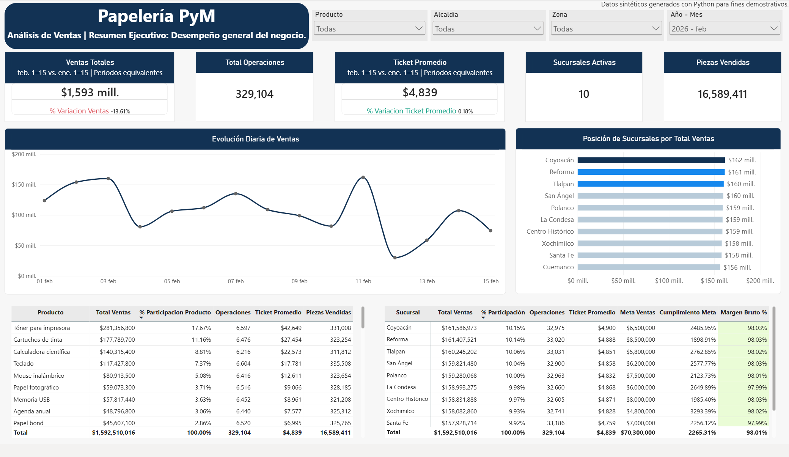
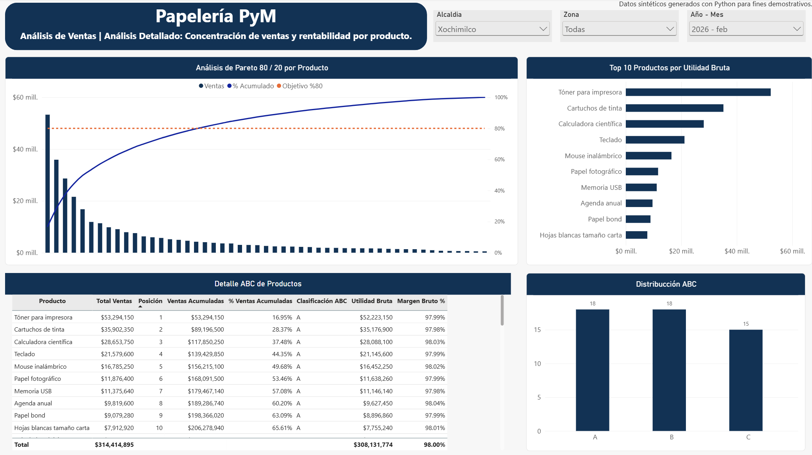

# 📊 Proyecto de Business Intelligence | Papelería PyM

### 🐍 Python | 🗄️ SQL | 📊 Power BI | ⚙️ Automatización | 📈 Data Analytics

---

## 📌 Descripción del proyecto

Este proyecto simula un entorno empresarial de una cadena de papelerías, donde se desarrolla un flujo integral para la **generación, procesamiento, ingesta, almacenamiento, análisis y visualización de datos de ventas**.

El objetivo principal es integrar herramientas de **Python, SQL y Power BI** para construir una solución de Business Intelligence que permita automatizar procesos operativos, analizar información histórica y transformar datos comerciales en indicadores estratégicos para la toma de decisiones.

El proyecto está estructurado en tres componentes principales:

1. **Python:** generación de datos simulados, automatización de procesos e ingesta de información.
2. **SQL:** consulta, exploración y análisis de datos para responder preguntas de negocio.
3. **Power BI:** modelado de datos, desarrollo de medidas DAX y construcción de dashboards interactivos.

Esta arquitectura permite representar un flujo de trabajo de datos, desde su origen hasta su presentación mediante reportes ejecutivos.

> **Nota:** los datos utilizados en el proyecto son sintéticos, generados mediante Python con fines educativos y demostrativos.

---

## 🎯 Objetivos

- Desarrollar un proceso automatizado para generar y almacenar registros de ventas diarias.
- Implementar funciones reutilizables en Python para facilitar el procesamiento y la gestión de información.
- Construir una base de datos relacional utilizando SQLite3.
- Aplicar consultas SQL para explorar, transformar, agrupar y analizar información comercial.
- Diseñar un modelo de datos que facilite el análisis mediante Power BI.
- Desarrollar indicadores clave de rendimiento (KPIs) utilizando DAX.
- Construir dashboards interactivos para analizar el desempeño comercial.
- Identificar tendencias, oportunidades de mejora y patrones en las ventas.
- Transformar datos operativos en información accionable que contribuya a la toma de decisiones.

---

## 📂 Estructura del proyecto

```text
Proyecto_Papeleria/
│
├── pym_externo.py
│   └── Funciones de generación, ingesta y consulta
│
├── analisis.ipynb
│   └── Consultas SQL y análisis de negocio
│
├── Ventas Papelería PyM.pbix
│   └── Dashboard desarrollado en Power BI
│
├── imagenes/
│   ├── dashboard_principal.png
│   └── analisis_detallado.png
│
└── README.md
    └── Documentación general del proyecto
```

La solución utiliza una base de datos SQLite3 denominada `VentasPrueba.db`, cuyo archivo puede mantenerse fuera del repositorio y cuya ubicación debe configurarse en el entorno de ejecución.

---

## 🐍 1. pym_externo.py | Procesamiento y automatización

Módulo desarrollado en Python que concentra las funciones necesarias para gestionar el flujo de información comercial de la papelería.

Su objetivo es automatizar la generación y almacenamiento de registros de ventas, reduciendo la intervención manual y facilitando la disponibilidad de información para los procesos analíticos.

### 🔧 Principales funcionalidades

- Generación de registros de ventas simulados.
- Construcción y manipulación de estructuras de datos mediante Pandas.
- Implementación de funciones reutilizables para el procesamiento de información.
- Ingesta y almacenamiento de datos en SQLite3.
- Automatización de procesos de carga de información.
- Ejecución de consultas SQL desde Python.
- Administración de catálogos de productos y precios.
- Organización y documentación de funciones para facilitar su mantenimiento.

**Propósito:** construir un proceso de datos organizado y reutilizable que permita simular las operaciones comerciales de una empresa y alimentar una base de datos histórica.

**Habilidades desarrolladas:** Python, Pandas, automatización, SQL, manipulación de datos y fundamentos de Data Engineering.

---

## 🗄️ 2. analisis.ipynb | Análisis de datos con SQL

Notebook desarrollado para explorar y analizar la información comercial almacenada en la base de datos SQLite3.

Este componente se enfoca en transformar consultas SQL en respuestas a preguntas relevantes del negocio, aplicando técnicas de análisis de datos y lógica comercial.

### 🔍 Actividades principales

- Exploración de tablas y estructuras de información.
- Aplicación de filtros y condiciones mediante SQL.
- Agrupación de registros y funciones de agregación.
- Implementación de consultas mediante JOIN.
- Uso de subconsultas y expresiones de tabla comunes (CTE).
- Construcción de cálculos condicionales mediante CASE WHEN.
- Análisis de ventas por sucursal, zona y periodo.
- Desarrollo de indicadores comerciales mediante consultas SQL.
- Interpretación de resultados para identificar oportunidades de mejora.

### 💡 Preguntas de negocio

- ¿Qué sucursales generan mayores ingresos?
- ¿Cómo evolucionan las ventas durante un periodo determinado?
- ¿Qué zonas comerciales presentan mejores resultados?
- ¿Cuáles son los productos con mayor participación en los ingresos?
- ¿Qué sucursales cumplen con sus objetivos comerciales?
- ¿Cómo se distribuyen los ingresos entre los distintos meses?
- ¿Qué patrones pueden identificarse en las operaciones diarias?

**Propósito:** aplicar SQL como herramienta de análisis para transformar datos almacenados en información relevante para el negocio.

**Habilidades desarrolladas:** SQL básico-intermedio, consultas analíticas, agregaciones, JOIN, CTE, lógica condicional y resolución de preguntas comerciales.

---

## 📊 3. Power BI | Dashboard de análisis comercial

Desarrollo de un dashboard interactivo en Power BI utilizando los datos históricos de ventas almacenados en SQLite3.

El objetivo es integrar procesos de transformación, modelado y visualización de datos para construir una herramienta que permita monitorear el desempeño comercial y facilitar la toma de decisiones.

El reporte está organizado en dos páginas:

1. **Resumen Ejecutivo:** visión general de las ventas y el desempeño de las sucursales.
2. **Análisis Detallado:** concentración de ventas, clasificación ABC y rentabilidad por producto.

### 🔧 Preparación y modelado de datos

- Conexión con la información almacenada en SQLite3.
- Transformación y preparación de datos mediante Power Query.
- Construcción de un modelo de datos relacional.
- Implementación de una dimensión de fechas (DimFecha).
- Creación de relaciones entre tablas de hechos y dimensiones.
- Desarrollo de medidas DAX para calcular indicadores comerciales.
- Aplicación de filtros y segmentadores para facilitar la exploración de información.

---

## 📸 4. Visualización del Dashboard | Power BI

### 📊 4.1 Resumen Ejecutivo | Desempeño General del Negocio



Esta página proporciona una visión general del desempeño comercial de la papelería mediante indicadores clave de rendimiento y visualizaciones interactivas.

#### Indicadores principales

| Indicador | Descripción |
|---|---|
| Ventas totales | Ingresos generados durante el periodo seleccionado |
| Variación de ventas | Comparación porcentual contra un periodo equivalente anterior |
| Total de operaciones | Número de transacciones comerciales registradas |
| Ticket promedio | Ingreso promedio generado por operación |
| Variación del ticket promedio | Cambio porcentual respecto al periodo de comparación |
| Sucursales activas | Cantidad de establecimientos con actividad comercial |
| Piezas vendidas | Volumen total de unidades comercializadas |

#### Análisis visuales

- **Evolución diaria de ventas:** identificación de tendencias y variaciones en los ingresos.
- **Posición de sucursales por ventas:** comparación del desempeño comercial entre establecimientos.
- **Desempeño por producto:** evaluación de ingresos, participación, operaciones y unidades vendidas.
- **Desempeño por sucursal:** análisis del ticket promedio, cumplimiento de metas y margen bruto.

#### Segmentadores interactivos

El dashboard permite explorar la información mediante filtros de:

- Producto.
- Alcaldía.
- Zona comercial.
- Año y mes.

**Objetivo:** proporcionar a la dirección una herramienta de monitoreo comercial que permita identificar cambios en las ventas, comparar sucursales y evaluar el comportamiento de los principales indicadores.

---

### 📈 4.2 Análisis Detallado | Productos y Rentabilidad



Esta página se enfoca en estudiar la concentración de ingresos y el desempeño económico de los productos, utilizando herramientas de análisis como Pareto, clasificación ABC y métricas de rentabilidad.

#### Análisis desarrollados

**1. Análisis de Pareto 80/20 por producto**

Visualización que combina las ventas individuales por producto con su porcentaje acumulado de participación.

Permite identificar cuáles concentran una mayor proporción de los ingresos comerciales.

**2. Clasificación ABC de productos**

Segmentación de productos de acuerdo con su participación acumulada en las ventas:

- **Categoría A:** productos que representan aproximadamente el primer 80 % de los ingresos acumulados.
- **Categoría B:** productos que representan el siguiente 15 %.
- **Categoría C:** productos que representan el porcentaje restante.

**3. Top 10 productos por utilidad bruta**

Ranking de los productos que generan mayor utilidad bruta, facilitando la identificación de aquellos que aportan más valor económico al negocio.

**4. Detalle ABC de productos**

Tabla analítica que integra:

- Total de ventas.
- Posición o ranking comercial.
- Ventas acumuladas.
- Porcentaje acumulado.
- Clasificación ABC.
- Utilidad bruta.
- Margen bruto porcentual.

**5. Distribución ABC**

Gráfico que presenta la cantidad de productos pertenecientes a cada categoría ABC.

**Objetivo:** identificar productos estratégicos, evaluar la concentración de ingresos y analizar oportunidades de mejora en la rentabilidad comercial.

---

## 🧮 5. Desarrollo de medidas DAX

Implementación de medidas para construir indicadores dinámicos que respondan a los filtros aplicados en Power BI.

### Principales indicadores

| Indicador | Aplicación |
|---|---|
| Ingresos totales | Medición del valor total de ventas |
| Total de operaciones | Conteo de transacciones comerciales |
| Ticket promedio | Valor promedio de las operaciones |
| Piezas vendidas | Cantidad de unidades comercializadas |
| Variación de ventas | Comparación del desempeño entre periodos |
| Ranking de productos | Ordenamiento según ingresos generados |
| Participación porcentual | Contribución de productos y sucursales |
| Ventas acumuladas | Cálculo progresivo de ingresos |
| Porcentaje acumulado | Base para el análisis de Pareto |
| Clasificación ABC | Segmentación según contribución comercial |
| Utilidad bruta | Diferencia entre ingresos y costos |
| Margen bruto | Porcentaje de rentabilidad sobre ingresos |
| Cumplimiento de metas | Comparación entre ventas y objetivos comerciales |

El desarrollo de estas medidas permite aplicar lógica de negocio dentro del modelo semántico y obtener resultados dinámicos según el contexto de filtros.

---

## 🛠️ 6. Tecnologías y herramientas

| Tecnología | Aplicación |
|---|---|
| Python | Automatización y procesamiento de datos |
| Pandas | Manipulación y preparación de información |
| SQLite3 | Almacenamiento de datos relacionales |
| SQL | Consultas y análisis comercial |
| Google Colab / Jupyter Notebook | Desarrollo de análisis y documentación |
| Power BI Desktop | Construcción de dashboards interactivos |
| Power Query | Transformación y preparación de datos |
| DAX | Desarrollo de medidas e indicadores |
| GitHub | Control de versiones y documentación |

---

## 🔄 7. Arquitectura y flujo general de datos

El proyecto integra diferentes etapas del ciclo de vida de la información:

```text
         GENERACIÓN DE DATOS
                Python
                  │
                  ▼
       PROCESAMIENTO E INGESTA
             Python + Pandas
                  │
                  ▼
        ALMACENAMIENTO DE DATOS
                SQLite3
                  │
          ┌───────┴────────┐
          │                │
          ▼                ▼
      ANÁLISIS SQL    TRANSFORMACIÓN
      analisis.ipynb    Power Query
                           │
                           ▼
                     MODELO DE DATOS
                        Power BI
                           │
                           ▼
                      MEDIDAS DAX
                           │
                           ▼
                    DASHBOARD POWER BI
                           │
               ┌───────────┴───────────┐
               │                       │
               ▼                       ▼
         RESUMEN EJECUTIVO       ANÁLISIS DETALLADO
               │                       │
               └───────────┬───────────┘
                           ▼
                   TOMA DE DECISIONES
```

Este flujo representa la integración de Python, SQL y Power BI como herramientas complementarias para la gestión y el análisis de información comercial.

---

## 📈 8. Valor del proyecto

Este proyecto representa una solución práctica de Business Intelligence que integra diferentes etapas del ciclo de vida de los datos.

Su principal aportación consiste en demostrar cómo una organización puede aprovechar información operativa para construir herramientas analíticas que faciliten el seguimiento de resultados comerciales.

### Desde una perspectiva técnica

Permite aplicar conocimientos de:

- Automatización y procesamiento de datos.
- Administración de bases de datos relacionales.
- Consultas SQL orientadas al análisis.
- Transformación y preparación de información.
- Modelado de datos.
- Desarrollo de medidas DAX.
- Visualización y comunicación de resultados.

### Desde una perspectiva de negocio

Permite:

- Monitorear el comportamiento de las ventas.
- Identificar productos con mayor contribución a los ingresos.
- Comparar el desempeño entre sucursales.
- Analizar tendencias y variaciones comerciales.
- Evaluar indicadores de rentabilidad.
- Identificar oportunidades de mejora.
- Facilitar la interpretación de información para la toma de decisiones.

El enfoque combina habilidades de **Data Analytics, Business Intelligence y fundamentos de Data Engineering**, aplicadas a un caso práctico que representa procesos habituales dentro de un entorno empresarial.

---

## 👨‍💻 Autor

**Jorge Luis Ordoñez García**

*Ingeniero en Sistemas Computacionales | Business Intelligence | Data Analytics*

Proyecto desarrollado como parte del fortalecimiento de habilidades técnicas en Python, SQL, Power BI, automatización y análisis de datos, con un enfoque práctico en la transformación de información operativa en soluciones analíticas para el negocio.

---

⭐ *Los datos por sí solos son registros; su verdadero valor surge cuando se transforman en información que permite comprender el negocio y tomar mejores decisiones.*
